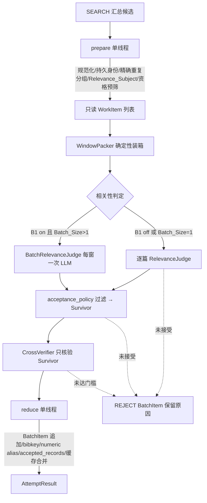

# Design Document

> **Spec：Retrieval Throughput（文献检索吞吐优化）**
> 本设计只优化 `literature` 检索链路的**吞吐模型**——批量相关性判定（B1）、管线重排（B2）、
> 有界并行（B3）——在**不改变检索结论正确性口径**（严格核验、引用配额、相关性缓存键 schema）
> 的前提下，把典型 20 篇任务的中位 active elapsed 降至不超过 10 分钟且相对基线降低至少 60%。
> 全部新能力默认关闭，关闭时逐字节走 legacy 路径。

## Overview

现状瓶颈（已对代码核实）：`run_attempt` 对每篇候选**串行**做「先严格交叉核验（多次网络往返）→
后逐篇 LLM 判相关（每篇一次 `structured_call`）」。100 篇候选 = 100 次串行 LLM + 数百次串行
verify 网络调用。

本设计三条主线，按上线顺序 B1 → B2 → B3，各自独立 flag、可独立回滚：

- **B1 批量相关性判定**：新增 `BatchRelevanceJudge`，一次 LLM 调用判一个窗口（≤ M 篇且 ≤ 输入
  预算）；仅当 token/字符预算不额外拆窗时，first-pass 调用数 N → ⌈N/M⌉。使用**独立版本化**的 batch prompt/schema，其 `judge_key`
  与单篇不同，缓存不串味。
- **B2 管线重排**：`run_attempt` 由「dedup→filter→verify→relevance」改为「dedup→filter→
  **relevance→verify（只核验 Survivor）**」，并拆成 **prepare（单线程）→ judge → verify →
  reduce（单线程）** 四段，为并发和批量提供无共享可变状态的中间形态。顺带修 Relevance_Subject
  的 content_hash seam（D6）。
- **B3 有界并行**：注入 `ConcurrencyExecutor`，在只读工作项之间并发跑批量判定窗口与 Survivor
  核验；结果由单线程 reducer 确定性归并。预算用**原子 reservation**、同键用 **single-flight**。

设计红线：`literature` 不依赖上层；executor / 预算 / clock / provider policy / batch 参数全部注入；
`BudgetLedger` 仍是唯一权威预算源。

## Architecture

### 重排后的单轮 attempt 数据流



并发（B3）只作用于 `JB/J1`（判定）与 `V`（核验）两段——它们对 `WorkItem` 是只读的；`prepare`
与 `reduce` 恒单线程，杜绝对 `accepted_records` / `Batch` / `Ledger` 的并发写。

### Feature 组合执行矩阵

B1 必须能先于 B2 独立上线，因此不能只有“重排后批量”一条新路径：

| B1 | B2 | B3 | 阶段顺序 | 说明 |
|---|---|---|---|---|
| off | off | off | 原 `run_attempt` | 直接调用 `_run_attempt_legacy`，逐字节不变 |
| off | off | on | 原逐候选顺序；CrossVerifier 内多 identifier 可并发 | 不跨候选推测执行，保持 accepted_records 语义 |
| on | off | off/on | legacy prepare → verify → batch judge → reduce | 保留核验在前，只把幸存待判项按窗批量化 |
| off | on | off/on | prepare → per-item judge → verify Survivor → reduce | 单独验收管线重排收益与语义等价 |
| on | on | off/on | prepare → batch judge → verify Survivor → reduce | 完整 B1+B2；B3 只改变 I/O 调度 |

- `B3=on` 不改变上述阶段先后，只并发当前阶段内的只读 I/O；
- 当 B1/B2 都关闭时，没有安全的批量 WorkItem 边界，B3 只启用单候选内部多 identifier 并发；
  跨候选并发从 B1 staged path 或 B2 prepare path 开始，避免为追求并发破坏 legacy accepted_records；
- 三 flag 虽可独立开关，但默认发布顺序固定为 B1 → B2 → B3；
- `_run_attempt_legacy` 保留为独立函数，flag 全关时不得进入新 prepare/reduce 或新缓存协调层；
- B1-only 路径继续使用 legacy 的逐候选 exact/disposition 纪律；B2 打开后才使用 Requirement 4.3 的
  批内完整分组与 `Relevance_Subject` 重排逻辑，避免把 B2 的行为变化混入 B1 性能归因。
- B1-only 以有界窗口为提交单元：使用窗口开始时的 accepted_records 做稳定预分类，窗口内同一
  high-confidence work-key 只保留元数据最完整项进入昂贵阶段，窗口 judge/reduce 完成后才构造下一窗；
  不得先处理全部候选再一次性更新 accepted_records。

### 分层与注入

```
application/literature_composition.py   ← 读 config，装配注入
  ├─ build BatchRelevanceJudge(reviewer_llm, batch_judge_version, window_packer)
  ├─ build ActiveRelevanceRuntime + batch-aware preflight evaluator
  ├─ build ConcurrencyExecutor + ProviderCallGate         # B3 flag 关 → None/serial
  ├─ build ExternalCallControl(BudgetLedger/cancel/deadline/gate)
  └─ AttemptDeps(+ runtime / executor / single-flight / call control)
literature/retrieval/attempt.py         ← 领域逻辑，全部依赖注入
literature/relevance_batch.py (新)      ← BatchRelevanceJudge + WindowPacker
literature/retrieval/budget.py          ← BudgetLedger + 原子 reservation
literature/retrieval/concurrency.py     ← 惰性有界调度 + provider call gate
```

## Components and Interfaces

### 1. `BatchRelevanceJudge`（新，`literature/relevance_batch.py`）

职责：一次 LLM 调用判一个 `RelevanceWindow`，产出与单篇 `RelevanceJudge` **同型**的
`RelevanceAssessment` 列表。复用 `relevance.py` 的 rubric 常量、`relevance_content_hash`、
`clean_relevance_fields`、`wrap_as_data`、`structured_call`。

```python
BATCH_PROMPT_VERSION = "relevance-batch-v1"
BATCH_SCHEMA_VERSION = "relevance-batch-schema-v1"

@dataclass(frozen=True)
class WindowItem:
    candidate_key: str        # 稳定、不含用户文本（如 "c0","c1"…，仅窗口内唯一）
    reference_id: str         # Persistent_Reference_Id（入键身份）
    clean_title: str
    clean_abstract: str
    has_abstract: bool
    content_hash: str         # 基于 Relevance_Subject 文本（D6）

@dataclass(frozen=True)
class RelevanceWindow:
    items: tuple[WindowItem, ...]     # len ≤ Batch_Size 且 ≤ Batch_Input_Budget

class BatchRelevanceJudge:
    def __init__(self, reviewer_llm, *, judge_version: JudgeVersion,
                 text_policy: RelevanceTextPolicy): ...
    @property
    def judge_version(self) -> JudgeVersion: ...   # batch 版本，key() 与单篇不同
    def assess_window(self, window: RelevanceWindow, criteria: RelevanceCriteria,
                      *, call_control: ExternalCallControl) -> dict[str, RelevanceAssessment]:
        """返回 candidate_key -> RelevanceAssessment。缺失 key → 该项 ERROR。"""
```

批量工具 schema（新）`report_relevance_batch`：

```json
{"name": "report_relevance_batch",
 "parameters": {"type":"object","required":["results"],"properties":{"results":{"type":"array","items":{
   "type":"object","required":["candidate_key"],"properties":{
     "candidate_key":{"type":"string"},
     "verdict":{"type":"string","enum":["relevant","weakly_relevant","unrelated"]},
     "confidence":{"type":"string","enum":["high","medium","low"]},
     "matched_aspects":{"type":"array","items":{"type":"string"}},
     "mismatch_aspects":{"type":"array","items":{"type":"string"}},
     "reason_code":{"type":"string"},"rationale":{"type":"string"}}}}}}}
```

绑定与失败纪律（Req 3）：
- 顶层先校验 `results` 容器，再对每 item 独立校验字段/枚举（Req 3.7）。
- `structured_call` 当前只负责 provider/JSON/tool-args 四态收敛，不执行 JSON Schema 逐字段验证；
  因此 BatchRelevanceJudge 必须自行做 envelope 与 item 两级校验，不能假设 schema 已替它完成。
- 用 `candidate_key` 显式绑定；**拒绝重复 key、未知 key、一 key 多结果**；缺失 key → 该候选
  `status=ERROR, error_kind="schema_failed"`（Req 3.6）。
- 整次调用 `structured_call` 失败 → 窗口内每项按 `call_status` 映射同一 `error_kind`（Req 3.3）。
- title_only 降级、untrusted 清洗与单篇完全一致（复用同函数）。

### 2. `RelevanceTextPolicy` + `WindowPacker`（新，`relevance_runtime.py` / `retrieval/window_packer.py`）

`content_hash` 必须基于**真正送入 Judge 的最终文本**。WindowPacker 不得在 hash 计算后再次截断
`WindowItem`，否则 attempt 写入与 preflight/build_bundle 读取会再次错位：

```python
@dataclass(frozen=True)
class RelevanceTextPolicy:
    version: str
    max_title_chars: int
    max_abstract_chars: int

def prepare_relevance_text(title, abstract, policy) -> PreparedRelevanceText:
    """清洗、按 policy 截断，再基于最终 title/abstract 计算 content_hash。"""
```

- legacy judge 继续使用现有固定上限与 hash，flag 全关时键值不变；
- batch judge 使用版本化 policy；`text_policy.version + BatchInputBudget canonical hash` 编入有效
  batch schema_version/judge_key，保证任何可能改变文本或窗口语境的预算变化安全失效旧缓存；
- attempt、B1 preflight backfill、`assess_availability` 与 `build_bundle` 必须注入同一 policy/hasher；
- 单项超过窗口预算时先由 policy 生成能独立成窗的最终文本并重新计算 hash，Packer 本身只装箱不改文本。

```python
@dataclass(frozen=True)
class WindowLimits:
    batch_size: int
    input_budget: BatchInputBudget

class WindowPacker:
    def __init__(self, *, limits: WindowLimits, token_estimator=None): ...
    def pack(self, items: Sequence[WindowItem], *, base_prompt_cost: int) -> list[RelevanceWindow]:
        """按输入序贪心装箱：任务标准/envelope 与 items 的累计成本不超过输入预算，
         且 count ≤ batch_size 才并入当前窗；超限则封窗新开。
        items 已是最终 PreparedRelevanceText；不得二次截断。"""
```

`BatchInputBudget`（注入）：`max_input_tokens`（有可靠 tokenizer 时）、`max_input_chars`（保守兜底）、
`max_output_tokens/max_output_chars`。窗口成本包含 system prompt、RelevanceCriteria、schema/envelope
和全部 item，不只计算摘要。容量控制不以篇数为唯一约束（Req 1.8）。
`batch_size=1` 时每项独立成窗，等价逐篇（零回归开关之一）。

### 3. 重排后的 `run_attempt`（改，`attempt.py`）

拆为四个内部阶段函数，`run_attempt` 编排：

```python
def _prepare(candidates, quota, deps) -> tuple[list[WorkItem], list[BatchItem]]:
    """单线程：clean/snapshot → 语言 → 精确去重分类(classify_exact) → 持久身份/disposition
    解析 → Relevance_Subject 构造(D6) → 资格预筛。产出只读 WorkItem 与预拒 BatchItem。
    同一持久身份/高置信 work-id 的多候选先用既有确定性 merge 规则形成 group subject；若仍需
    选代表，评分顺序固定为：Ledger existing > 有摘要 > 高置信标识符完整度 > 核心元数据字段
    完整度 > 输入序。其余成员仍各自产 BatchItem 并关联 group key（Req 4.3）。"""

def _judge(work_items, criteria, deps, *, mode) -> dict[str, RelevanceAssessment]:
    """先查 Relevance_Store（命中不入窗，Req 13.1/13.2）；未命中项经 WindowPacker 装箱，
    mode=batch 且 Batch_Size>1 → BatchRelevanceJudge.assess_window，否则逐篇 RelevanceJudge.assess。
    可经 executor 在窗口/候选间并发（B3）。"""

def _verify_survivors(survivors, deps) -> dict[str, VerificationAssessment]:
    """只对相关性被接受的 Survivor 调 CrossVerifier（Req 4.4）。可并发（B3）。"""

def _reduce(work_items, judgements, verifications, batch, deps) -> AttemptResult:
    """单线程：按稳定序落 disposition，分配 bibkey/numeric alias，更新 accepted_records，
    构造 ProposedRecordSnapshot，写 Relevance_Store（merge_put），产出 AttemptStats。"""
```

`WorkItem`（只读，prepare 产出）：候选快照、`Relevance_Subject`（送 judge 的规范记录）、
`exact`（ExactMatch）、`language_verdict`、`resolved_reference_id`、`content_hash`。

`Relevance_Subject` 规则（D6）：reuse → Ledger 现有记录；merge → 确定性合并后记录；
accept_new → 规范化候选记录。`content_hash` = `relevance_content_hash(subject.title,
subject.abstract)`，送 judge 的文本亦取 subject，使写入端与 preflight/build_bundle 读取端一致。

**零回归**：B1/B2/B3 三 flag 全关、`executor is None` 且 `batch_size==1` 时，`run_attempt` 保留原
「dedup→filter→verify→relevance」串行逻辑分支，逐字节等价（D9）。重排 flag 独立于批量/并发。

### 4. Active Relevance Runtime 与 preflight 贯通

batch 与逐篇 judge_key 必须隔离，但 `assess_availability` / `build_bundle` 当前只接收一个
`judge_key`。若只改 attempt，B1 写入 batch key、下游仍读取 per-item key，会使新结果不可见；反过来
切到 batch key，又会让既有 Ledger 记录的 per-item 缓存全部不可见。因此每个 operation 冻结同一个
active runtime：

```python
@dataclass(frozen=True)
class ActiveRelevanceRuntime:
    evaluator: object                 # RelevanceJudge | BatchRelevanceJudge
    judge_key: str
    text_policy: RelevanceTextPolicy
    batch_enabled: bool
```

- composition 把同一 runtime 注入 attempt、preflight relevance preparation、
  `assess_availability` 与 `build_bundle`；读取端不再自行猜 judge_key/hash policy；
- B1 开启时，在 availability 统计前对严格核验且过 eligibility 的 Ledger 记录执行
  `ensure_relevance` 的 batch-aware 版本，只补 active key 的 cache miss，并与 RetrievalLoop 共用
  BudgetLedger；这样既有文献不会因为 judge_key 切换而被误判为全部不可用；
- B1 的单项失败重试仍使用 batch schema/text policy/judge_key，不调用 legacy Per_Item_Judge 后
  冒充 batch key；
- B1 关闭/回滚时 active runtime 恢复 legacy per-item key，batch 缓存保留但不会错误命中；
- flag 全关时不接入新的 preflight backfill，保持现有行为逐字节不变。

跨 turn 暂停恢复不能只在内存里“冻结”：application 层同时创建可序列化
`ThroughputPolicySnapshot`（flags、WindowLimits、text policy/version、JudgeVersion、阶段/provider
并发、timeout/retry/grace），其 canonical hash 写入 PreflightCheckpoint。session pending flow 保存
snapshot payload；恢复时按 snapshot 重建 runtime 并校验 hash。当前 provider/model 已不可用时返回
typed resume error，不得悄悄换 JudgeVersion 或并发/预算策略。

### 5. 并发执行（B3，`ConcurrencyExecutor` 抽象注入）

```python
class ConcurrencyExecutor(Protocol):
    def map_ordered(self, fn, items, *, max_in_flight: int,
                    cancel_token, per_task_timeout_s: float,
                    shutdown_grace_s: float) -> list[TaskOutcome]: ...
    # 必须惰性提交（在飞完成后才补下一个），取消时尝试取消 queued task，按输入序返回 outcome
```

- 全局 `Concurrency_Limit`、阶段级上限（relevance/verify）、`Provider_Concurrency_Policy`
  三者取最小值决定实际在飞数（Req 6.3）。
- `map_ordered` 不能一次性把全部 items 提交到底层线程池，否则预算/取消后仍会运行排队任务；
- provider 未声明线程安全或其 policy 上限=1 → 该 provider 串行（Req 6.11）。
- 单候选多标识符并发 fetch 时仍按 `(id_type, normalized_id)` 排序赋 `seq`（Req 6.2）。
- `literature` 不 close/长持有 executor，生命周期归组合层（Req 6.10）。

executor 只控制任务数量，无法知道 worker 内部调用了哪个 provider；provider 级约束由独立 gate 执行：

```python
class ProviderCallGate(Protocol):
    def enter(self, provider_name, capability, *, cancel_token,
              deadline_at) -> ProviderLease | None: ...
```

`ProviderLease` 负责 keyed semaphore/QPS/Retry-After/backoff 纪律；BatchRelevanceJudge、CrossVerifier
和并发 search/verify adapter 在真正调用 provider 前进入 gate。未知/非线程安全 provider 的 lease
上限为 1。不能仅把 policy 塞进 ThreadPoolExecutor 后宣称已实现 provider 限流。

### 6. 原子预算预留 + Single-Flight（`budget.py` + 协调层）

`BudgetLedger` 增加线程安全的 reservation：

```python
def try_reserve(self, dims: dict[str,int]) -> Reservation | None:
    """加锁：若各维度 reserved+used+dims 均未触顶 → 记 reserved 并返回票据；否则 None。"""
def mark_started(self, r: Reservation) -> None: """紧邻外部调用前标记已开始。"""
def settle(self, r: Reservation) -> None:   """已开始调用结束：reserved→used，无论结果。"""
def release(self, r: Reservation) -> None:  """调用未发出即取消：撤销 reserved。"""
```

调用边界由 operation-scoped `ExternalCallControl` 统一组合，避免每个 worker 各自决定顺序：

```python
class ExternalCallControl:
    def execute(self, *, provider_name, capability, budget_dims,
                cancel_token, deadline_at, single_flight_key=None, fn) -> CallOutcome: ...
    # 顺序：single-flight leader → reserve → provider gate → 再检 cancel/deadline
    #      → mark_started → fn → finally settle/lease release → telemetry
```

- worker 发出外部调用前必须 `try_reserve`；在 provider 调用的前一刻再次检查 cancel/deadline，
  然后 `mark_started`；调用结束在 `finally` 中 `settle`，包括 exception/timeout；未开始即取消 → `release`
  （Req 7.4/7.5）。取代「check 后再 charge」的竞态。
- **Single-Flight**（`relevance_store` / `verify_cache` 前置协调层）：同一缓存键并发 miss 只放
  一个外部调用在飞，其余等待复用结果、不重复预留（Req 13.5/7.9）。
- 计数细分：`relevance_items_judged` / `relevance_windows` / `relevance_llm_calls`（批量一次调用
  +1 llm_call、+window item 数，Req 7.6）。
- `provider_time_budget_s` 明确为基于注入 monotonic clock 的 Loop **墙钟截止**，并发下不把各
  provider latency 求和当第二套停止预算（Req 7.8，与现状一致）。
- reservation 必须位于实际 `llm.complete` / `fetch_metadata` 边界。`structured_call` 在
  forced-tool 参数不受支持时可能内部再调用一次 `llm.complete`；该物理重试也必须单独预留/结算，
  不能只在 `assess_window` 外层按一次逻辑调用记账。实现可采用 budget-aware provider wrapper，
  或给统一 structured-call 层增加可选 attempt hook；旧调用不传 hook 时行为不变。
- Retry-After/backoff 的 clock、sleep 与 jitter source 必须注入，测试不得真实 sleep；每一次重试都
  重新经过 cancel/deadline、reservation 与 provider gate，且不允许持有 semaphore 睡眠。
- 新路径不再由 `loop.py` 根据 `relevance_items_judged` 事后 `charge_llm`；Loop 只汇总已结算统计，
  避免批量按 item 多记或 provider wrapper 与外层双重记账。Legacy 分支保留原记账方式。

### 7. 配置与装配（`config.py` + `literature_composition.py`）

新增 config 字段（默认使能力关闭）：

| 字段 | 默认 | 作用 |
|---|---|---|
| `literature_relevance_batch_enabled` | False | B1 flag |
| `literature_relevance_batch_size` | 1 | M；>1 才批量 |
| `literature_relevance_batch_input_chars` | 12000 | 单窗输入字符预算 |
| `literature_relevance_batch_input_tokens` | None | 有可靠 tokenizer 时的单窗 token 上限 |
| `literature_relevance_batch_output_tokens` | provider default | 单窗最大输出 token |
| `literature_pipeline_reorder_enabled` | False | B2 flag |
| `literature_retrieval_concurrency` | 1 | B3 全局并发上限；>1 才并发 |
| `literature_retrieval_concurrency_enabled` | False | B3 flag（注入 executor） |
| `literature_relevance_stage_limit` | 1 | 同时在飞相关性窗口上限 |
| `literature_verify_stage_limit` | 1 | 同时在飞核验任务上限 |
| `literature_provider_policy` | conservative | provider→线程安全/max_in_flight/QPS/timeout/backoff |
| `literature_shutdown_grace_s` | 5 | 取消后的收束宽限，不允许无界等待 |
| `literature_batch_retry_limit` | 1 | 失败子集最大重试次数；不得大于 1 |

`build_writing_orchestrator` 据 flag 装配：batch judge（独立 `JudgeVersion(prompt_version=
BATCH_PROMPT_VERSION, schema_version=BATCH_SCHEMA_VERSION)`）、ActiveRelevanceRuntime、executor、
ProviderCallGate、SingleFlight 与 reservation 协调层，注入进 `AttemptDeps`/preflight。每个 operation
冻结 flags/batch limits/text policy/provider policy/JudgeVersion 快照（Req 14.3）。配置校验拒绝
负数/零预算、batch flag 开但 size<2、retry_limit>1，以及没有 timeout 的并发 provider policy。

### 8. 可观测 trace（复用现有隐私安全 sink）

在 `loop.py._trace_record` / attempt 统计扩展（只 hash/计数/预算，Req 12.3/12.6）：
`relevance_windows`、`window_item_hist`、`est_input_chars`、`truncated_items`、
`first_pass_llm_calls`、`retry_llm_calls`、`batch_error_kinds`、`concurrency_used`、
`reservation_{granted,rejected,released,settled}`、`single_flight_waiters`、`cache_hits`、
`provider_429/timeout/backoff`、全局/阶段/provider 配置与实际最大在飞、executor queue time、
prepare/judge/verify/reduce 各阶段 wall-clock。事件带 operation/attempt/window 标识，确定性关联
（Req 12.7）。worker 只返回结构化 telemetry，由单线程 sink 汇总；不得从 worker 写普通日志。

## Data Models

- `WindowItem` / `RelevanceWindow` / `BatchInputBudget` / `WindowLimits`（新）。
- `RelevanceTextPolicy` / `PreparedRelevanceText` / `ActiveRelevanceRuntime`（新）。
- `WorkItem`（prepare 中间态，只读）。
- `Reservation`（预算票据：dims + 状态）。
- `TaskOutcome` / `CallOutcome` / `ProviderLease` / `ExternalCallControl`（并发与调用控制契约）。
- `ThroughputPolicySnapshot`（application/session 可序列化恢复 DTO，不进入 literature 领域依赖）。
- `RelevanceAssessment` **不变**（批量产出同型）。
- `RelevanceStore` 键 schema **不变**；batch 结果因 `judge_key` 含 batch 版本而与单篇并存、不互相
  覆盖（Req 5.7）。

## 设计决策（Decisions）

- **D1 批量 judge 独立版本化**：batch 用 `BATCH_PROMPT_VERSION/BATCH_SCHEMA_VERSION`，`judge_key`
  与单篇不同 → 批量/逐篇结果在 `RelevanceStore` 并存、不互相错误命中（Req 1.9/5.7）。
- **D2 candidate_key 显式绑定**：批量输入输出用窗口内稳定、不含用户文本的 key 对齐，不靠模型返回
  顺序；重复/未知/缺失 key 都安全降级为 per-item ERROR（Req 3.5/3.6）。
- **D3 容量按 token/字符预算 + 篇数双约束**：有可靠 tokenizer 时优先 token；否则用保守字符估算；
  单篇由 RelevanceTextPolicy 在 hash 前截断为可独立成窗的最终文本，Packer 不二次改写（Req 1.7/1.8）。
- **D4 单线程 prepare/reduce + 只读并发**：一切可变状态（accepted_records/bibkey/numeric alias/
  Batch/Ledger 写）收敛到单线程两端，中间对 WorkItem 只读并发 → 并发结果与串行语义等价且顺序确定
  （Req 6.5/6.6/6.7）。
- **D5 原子 Budget_Reservation**：以 reserve→settle/release 取代 check-then-charge，杜绝并发集体
  超额；`BudgetLedger` 仍是唯一权威源（Req 7.4/10.6）。Single-Flight 防同键重复昂贵调用（D5 附）。
- **D6 Relevance_Subject 修 content_hash seam**：判定文本 = 哈希文本 = Relevance_Subject（reuse→
  现有记录、merge→合并记录、accept_new→规范化候选），使 attempt 写入与 preflight/build_bundle 读取
  的 content_hash 一致。B2 的顺序等价性以“使用同一 Relevance_Subject 的 verify-first reference
  pipeline”为基线；seam 修复相对旧 bug 的差异单独报告，不能拿它豁免重排等价性（Req 5.6/9.4）。
- **D7 管线重排只核验 Survivor**：相关性视为核验前筛选而非可信证明；只有严格核验 + 单线程归并产
  ACCEPT_NEW（Req 4.8/5.1），核验网络调用降到 Survivor 未缓存可核验 identifier 数（Req 4.5）。
- **D8 三独立 flag + 逐字节零回归**：B1/B2/B3 各自 flag、可独立回滚，默认全关走 legacy；上线顺序
  B1→B2→B3，各过自身门槛后再开下一阶段（Req 9/14.4）。
- **D9 provider 背压注入**：`Provider_Concurrency_Policy`（max_in_flight/超时/线程安全/QPS/backoff）
  由组合层注入，未知 provider 用保守默认，非线程安全 provider 串行（Req 6.11/14.1）。
- **D10 验收项不得降级为占位**：≥200 条人工标注、≥30 次 replay P50/P95、≥5 个 live 配对、
  canary 与自动关闭均来自已批准 Requirements，是启用默认值的发布门槛；可以分 task 实施，但不能以
  Tier-2 名义从本 spec 的完成定义中删除。
- **D11 四种执行组合显式建模**：B1-only 保留 verify→batch relevance；B2-only 使用 per-item
  relevance→verify；B1+B2 使用 batch relevance→verify；全关直接走 `_run_attempt_legacy`。
- **D12 Single-Flight 属于 literature 内的通用机制**：放在 `literature/retrieval/single_flight.py`，
  只依赖泛型 key/value、局部同步原语、cancel/deadline，不 import store/provider/application/config；
  实例按 operation/Loop 注入，不做进程全局单例。
- **D13 文本准备先于 hash 与装箱**：`RelevanceTextPolicy` 先生成最终 Judge 文本并计算 hash，
  WindowPacker 只装箱、不二次截断；preflight/build_bundle 使用同一 active policy/hasher。
- **D14 暂停恢复冻结完整策略**：ThroughputPolicySnapshot 与 hash 随 pending flow 持久化；恢复时重建
  同一 active runtime，不能只冻结内存对象，也不能在配置变化后静默换 judge_key/窗口/并发策略。

## Correctness Properties

*属性（property）是系统所有合法执行下都应成立的特征或行为——一个关于「系统应当做什么」的
形式化陈述，是人类可读规格与机器可验证正确性保证之间的桥梁。*

以下属性由 prework 分析归并冗余后得到（例如「装箱双上限」与「⌈N/M⌉」合并为窗口装箱属性；
「仅 strict verified 可 ACCEPT_NEW」统一覆盖 4.1/4.8/5.1/5.2/5.5；single-flight 统一覆盖
6.8/7.9/13.5）。每个属性以 property-based 测试实现，最少 100 次迭代，tag 格式
**Feature: retrieval-throughput, Property N: <text>**。

### Property 1: 窗口装箱双上限与 ⌈N/M⌉

*对任意*候选序列与 `WindowLimits`，`pack_windows` 输出确定（同输入两次调用相等），每个窗口
`item_count <= batch_size` 且完整 prompt 的估算 token 成本（可用时）与保守字符成本均不超过各自
input budget；不存在“单篇例外可以
突破窗口上限”。
当所有候选文本均不触发字符预算时，窗口数恰为 ⌈N / batch_size⌉。

**Validates: Requirements 1.1, 1.2**

### Property 2: 单篇超预算截断且不丢候选

*对任意*初始文本超过单项预算的候选，`prepare_relevance_text` 先按 Active
RelevanceTextPolicy 生成最终文本并重算 content_hash；Packer 将该不可变 item 单独成窗且不再改写，
候选仍出现在某个窗口中（不静默丢弃、不突破上下文上限）。

**Validates: Requirements 1.7**

### Property 3: 装箱计量自洽

*对任意*候选序列，所有窗口的 `item_count` 之和等于（未命中缓存的）候选数 N，所有窗口
`truncated` 之和等于 `truncated_count`。

**Validates: Requirements 1.8**

### Property 4: 批量结果与逐篇同型且字段规则一致

*对任意*窗口与合法批量响应，每篇候选产出的 `RelevanceAssessment` 含全部必需字段，其
`reference_content_hash` 等于 active text policy 对实际送评文本计算的 hash，
`basis` 遵循 title_only/title_and_abstract 规则；无摘要候选即使模型回 relevant 也降为
`weakly_relevant/low`。

**Validates: Requirements 1.3, 1.4, 1.5**

### Property 5: batch 与逐篇 judge_key 隔离且共存

*对任意* provider/model，batch `JudgeVersion.key()` 不等于逐篇 `JudgeVersion.key()`；对同一
`(reference_id, task_fingerprint, reference_content_hash)`，批量与逐篇结果按各自 judge_key 在
`RelevanceStore` 共存，互不覆盖、互不错误命中；单项 fallback 重试产出的 assessment 使用同一
batch judge_key。

**Validates: Requirements 1.9, 5.7, 5.8, 13.8**

### Property 6: 候选身份显式绑定，不靠顺序

*对任意*窗口，将模型 `results` 任意重排后，每篇候选仍按其 `candidate_key` 拿到对应判定；
重复 key、未知 key、一 key 多结果被拒绝，缺失 key 只使对应候选失败，其余候选不受影响。

**Validates: Requirements 3.5, 3.6, 3.7**

### Property 7: 失败不伪装，部分/整批失败映射为 ERROR

*对任意*批量响应，缺失或非法的候选产出 `status=ERROR`、`verdict=None`、`error_kind` 明确
（provider_failed/parse_failed/schema_failed），绝不伪装为 relevant/unrelated；部分失败时成功
候选判定保留；整批调用失败时窗口内每篇产出对应 `error_kind` 的 ERROR。

**Validates: Requirements 3.1, 3.2, 3.3**

### Property 8: ERROR 不计入接受与配额

*对任意*含 ERROR 与 SUCCESS 混合的判定集合，`acceptance_policy.is_accepted` 对 ERROR 恒为
False，ERROR 候选从不进入 counted_reference_ids 或 ACCEPT_NEW。

**Validates: Requirements 3.4**

### Property 9: 有界重试只覆盖失败子集且最多一次

*对任意*首次失败子集，重试调用涉及的 `candidate_key` 集合是首次失败集合的子集，成功候选不被
重试，重试次数至多一次；重试仍失败时保留 ERROR。

**Validates: Requirements 3.8**

### Property 10: 批量调用分维计数自洽

*对任意*一批窗口，`relevance_llm_calls` 等于真实发生的 LLM 调用数（first_pass + partial_retry
分开计），`relevance_windows` 等于 first-pass 窗口数，`relevance_items_judged` 等于各窗口
`item_count` 之和；一次批量调用只增加一次 `llm_calls` 但增加对应 item 数。

**Validates: Requirements 3.9, 7.1, 7.6**

### Property 11: 同一作品只选唯一代表进相关性与核验

*对任意*开启 B2 且含重复 work-key 的候选集，prep 后同一持久身份只产出一个非 `batch_duplicate` 代表，
且代表按元数据完整度优先（稳定输入序 tie-break）选出；其余标为 batch_duplicate/merge
participant，不重复进入窗口或核验。

**Validates: Requirements 4.3**

### Property 12: 相关性先于核验，只核验 Survivor

*对任意*开启 B2 的候选集，`CrossVerifier` 仅对 Survivor（相关性被接受且 disposition==none）调用；被相关性
拒绝或 reuse/merge disposition 的候选不触发严格核验；核验候选调用数 ≤ Survivor 数，无 Survivor
时为零。

**Validates: Requirements 4.1, 4.4, 4.5, 4.6**

### Property 13: 只有严格核验通过才能 ACCEPT_NEW 并计入配额

*对任意*候选集与任意核验结果，所有 disposition 为 `ACCEPT_NEW` 的 BatchItem 其核验均
`meets_strict_threshold` 为真；相关性通过但核验未达门槛的候选被标为 REJECT 且原因前缀为
`verify:`；计入配额的记录必为 strict verified。

**Validates: Requirements 4.8, 5.1, 5.2, 5.3, 5.5**

### Property 14: 保留全部候选的 BatchItem

*对任意*候选集，去重后每个候选（无论接受或被各阶段拒绝）都有对应 `BatchItem`，被拒者带
非空 `rejection_reasons`，无候选被静默丢弃。

**Validates: Requirements 4.7**

### Property 15: Relevance_Subject 统一入键与哈希基准

*对任意* disposition，送入 Judge 的最终 PreparedRelevanceText 与 `reference_content_hash` 均基于同一 Relevance_Subject
（reuse=现有记录、merge=合并后记录、accept_new=规范化候选），且入键 `reference_id` 等于
Persistent_Reference_Id（非候选 transient id）。

**Validates: Requirements 5.4, 5.6**

### Property 16: 并发结果与串行语义等价且顺序确定

*对任意*候选集，使用并发 executor 与 `SerialExecutor` 执行产出的 `BatchItem` 接受/拒绝语义集合
相等；且在任意任务完成顺序下，最终 `BatchItem` 顺序按稳定键确定，不依赖完成先后。

**Validates: Requirements 6.4, 6.5, 6.6, 6.7**

### Property 17: 核验事件 seq 与并发无关

*对任意*候选的多标识符集合，无论 provider fetch 是否并发，`VerificationEvent.seq` 与按
`sorted (id_type, normalized_id)` enumerate 得到的序号一致。

**Validates: Requirements 6.2**

### Property 18: 并发上限三重取最小且遵守 provider 串行

*对任意* (global, stage, provider) 上限三元组，实际最大在飞任务数不超过三者最小值（任务数充足且
无取消/背压时可达到该值）；当某 provider
未声明线程安全或其 `max_in_flight==1` 时，对该 provider 的实际在飞恒为 1（即使全局上限更高）；
未知 provider 使用保守默认而非无限并发。

**Validates: Requirements 6.3, 6.11, 14.1**

### Property 19: Single_Flight 同键只一次外部调用

*对任意*数量的并发同键 miss，底层外部调用（LLM/provider）恰发生一次，等待者复用同一结果；缓存
命中路径与等待者都不消费新预算、不重复预留。

**Validates: Requirements 6.8, 7.9, 13.5**

### Property 20: 原子预留并发下不超额

*对任意*并发 `try_reserve`/`settle`/`release` 序列，任一维度的实际结算总数不超过其上限
（并发下不发生集体超额）；`reserve` 后未发出调用即 `release` 不计消费，已发出则 `settle` 恰计
一次，无论成功/provider error/parse/timeout。若 `structured_call` 在协议兼容分支实际执行两次
`llm.complete`，则必须有两张 reservation 并结算两次，不能按一次逻辑调用掩盖物理请求。

**Validates: Requirements 7.4, 7.5**

### Property 21: verify 记账与墙钟截止

*对任意* verify 调用序列，`verify_calls` 增量等于调用次数，单次 provider latency 只进 trace 不
汇入停止预算；`provider_time_budget_s` 以注入 monotonic clock 的 `elapsed_s` 为截止，并发下不把
各 latency 求和成第二套停止口径。

**Validates: Requirements 7.2, 7.8**

### Property 22: 任一预算维度触顶即停

*对任意*触顶维度（max_llm_calls / max_verify_calls / max_provider_calls /
provider_time_budget_s），触顶后不再发起新的批量判定或核验调用，包括不发起后续窗口。

**Validates: Requirements 7.7, 8.5**

### Property 23: 取消及时停止且记账自洽

*对任意*中断点（取消或预算耗尽），取消后不提交新任务、不新建外部工作、未开始的 Future 不执行、
返回后无后台任务再改 Batch/缓存；返回时 `settled + released == reserved`（无悬挂预留），
已记账调用对应已产出或已丢弃的 outcome（无半记账），并如实标注 `budget_stopped`/cancelled。

**Validates: Requirements 8.1, 8.2, 8.3, 8.4, 8.6**

### Property 24: 三 flag 全关逐字节等价 Legacy

*对任意*候选集，当 B1/B2/B3 三 flag 全关、batch_size=1、无外部 executor/provider gate 且未注入
batch judge 时，`run_attempt` 直接调用 `_run_attempt_legacy`，产出的 `BatchItem` 集合与
`AttemptStats` 与重构前逐字段相等。

**Validates: Requirements 9.1, 9.3**

### Property 25: 仅开重排的 accept_new 等价性

*对任意*候选集与固定 Relevance_Subject/Judge/Verifier 结果，仅开启管线重排（B2）时，所有
BatchItem 的接受/拒绝语义与使用相同 Relevance_Subject 的 verify-first reference pipeline 等价，
且核验候选调用数不超过 reference。seam 修复相对旧错误行为的差异作为独立迁移报告，不混入顺序对比。

**Validates: Requirements 9.4**

### Property 26: 缓存命中不重复入窗且重复运行幂等

*对任意*含 SUCCESS 缓存命中的候选集，命中候选不进入任何 `Relevance_Window`，仅未命中者组窗；
对同一候选集重复运行一次 attempt，成功缓存命中后产出与首次语义一致的接受/拒绝结果，且对应项
不产生新的 LLM 调用。首次 ERROR 不写缓存，后续重试 MAY 再调用，不应被本属性误判为不幂等。

**Validates: Requirements 13.1, 13.2, 13.3**

### Property 27: 缓存合并确定性与 confluence

*对任意*并发写同一缓存键的顺序，最终 `RelevanceStore` 状态确定且等于某个串行顺序的结果
（SUCCESS 优先 ERROR）；写入 `status=ERROR` 不覆盖同键既有 SUCCESS。

**Validates: Requirements 13.4, 13.6**

### Property 28: 重试幂等，不重复接受/别名/身份

*对任意*重试，复用同一 operation/attempt/window 身份并产生新的 attempt ordinal，不重复追加
`ACCEPT_NEW`、不重复分配 numeric alias、不产生重复 `BatchItem` 身份。

**Validates: Requirements 13.7**

### Property 29: 判定内容变化失效缓存，装箱/并发变化不改 TaskFingerprint

*对任意* batch prompt/schema/JudgeVersion、Batch_Input_Budget 或 RelevanceTextPolicy 版本变化，对应 judge_key
随之变化并安全失效旧缓存；*对任意*仅改变并发度或窗口装箱（不改判定内容）的变化，
`RelevanceCriteria.fingerprint()`（TaskFingerprint）不变。

**Validates: Requirements 13.8**

### Property 30: operation 冻结判准快照

*对任意*在 operation 运行中发生的全局配置变化，同一 operation 继续使用启动时冻结的 feature
flags / Batch_Size / Batch_Input_Budget / 并发策略 / JudgeVersion 快照，判准不在同一 Batch 中途
改变；配置变化只影响后续 operation。若 operation 跨 turn 暂停，恢复后重建 snapshot 的 canonical
hash 必须与 checkpoint 相等，否则 typed error 停止而不是静默换策略。

**Validates: Requirements 14.3**

### Property 31: 退避有界不无限重试

*对任意*持续返回 429/Retry-After 或可重试 transient error 的 provider，退避在同一预算内、次数
有上限、带 jitter，达上限后诚实失败，绝不无界重试或切换到无 authority 的 provider 伪装成功。

**Validates: Requirements 14.2**

### Property 32: 架构红线与 trace 隐私

*对任意* `literature` 包模块，其 import 不含 `tasking`/`application`/`session`/`config`；
*对任意*候选/query，新增 trace 输出不包含原始标题/摘要/query/candidate_key→标题映射原文，只含
digest/计数/预算。

**Validates: Requirements 10.1, 12.3, 12.6, 12.7**

### Property 33: Active relevance runtime 读写贯通

*对任意* operation，attempt 写入、preflight cache-miss 补判、availability 与 bundle 读取使用同一
active judge_key 与 RelevanceTextPolicy；B1 开启时 Ledger 旧记录先批量补 active-key miss，B1 关闭时
恢复 legacy key。不得出现 batch 写入成功但下游因读取另一个 key/hash 而不可见。

**Validates: Requirements 5.6, 5.7, 5.8, 13.8, 14.3**

### Property 34: Feature 组合阶段顺序正确

*对任意* B1/B2/B3 flag 组合：全关走 legacy；仅 B3 保持 verify→per-item relevance；仅 B1 保持
verify→batch relevance；仅 B2 为 per-item relevance→verify；B1+B2 为 batch relevance→verify；
B3 只改变阶段内调度，不改变阶段顺序
或判准。

**Validates: Requirements 9.1, 9.4, 9.5, 9.6**

## Error Handling

| 场景 | 处理 | 依据 |
|---|---|---|
| 批量整批调用失败（provider/parse/schema） | 窗口内每篇 ERROR + 对应 error_kind | 3.3 |
| 批量部分候选非法/缺失 | 保留成功 item，失败 item ERROR；两级校验不因单 item 非法丢其余 | 3.1/3.2/3.7 |
| 重复/未知 candidate_key、一 key 多结果 | 拒绝该结果；缺失 key → 对应候选 ERROR | 3.6 |
| 首次失败子集且预算/取消允许 | 最多一次拆窗/单项重试；成功不重试；仍失败保留 ERROR | 3.8 |
| 相关性接受但严格核验未达门槛 | REJECT，原因 `verify:<status>`，保留 BatchItem | 5.3 |
| 单篇文本超 Batch_Input_Budget | RelevanceTextPolicy 先截断并重算 hash，再以不可变 item 单独成窗 | 1.7/5.6 |
| 预留后调用未发出即取消 | `release`，不计消费 | 7.5 |
| 预留后调用已发出（任何结果） | `settle`，结算一次 | 7.5 |
| 任一预算维度触顶 | 停止发起新批量/核验，包括后续窗口；标注 budget_stopped | 7.7/8.5 |
| 取消信号 | 停止提交新任务，收束已提交，返回一致结果集，标注 cancelled | 8.1/8.3 |
| provider 429/Retry-After/transient | 同预算内有界带 jitter 退避；达上限诚实失败 | 14.2 |
| provider 未声明线程安全 / 上限=1 | 对该 provider 串行 | 6.11 |
| 未知 provider | 保守默认 policy，不无限并发 | 14.1 |
| B1 flag 关或 M=1 | 使用 Per_Item_Judge；是否重排/并发仍分别由 B2/B3 决定 | 9.5 |
| 三 flag 全关 | 直接走 `_run_attempt_legacy`，不进入新协调层 | 9.1 |
| active judge_key/text policy 与 checkpoint/runtime 不一致 | 拒绝继续该 operation，避免写一个 key、读另一个 key | 5.7/14.3 |
| structured_call 内协议兼容重试 | 每次实际 `llm.complete` 分别 reserve/settle，trace 标出 physical attempt | 7.4/7.5 |

## Testing Strategy

### 双测试路径

- **单元测试**：具体示例、边界与错误条件（如空候选集、单候选窗口、全命中缓存、整批失败、
  取消在不同检查点触发、未知 provider policy、四种 B1/B2 执行顺序、active judge_key 从 attempt
  写入到 preflight/bundle 读取、ThroughputPolicySnapshot 序列化/恢复/旧 envelope 迁移、
  structured_call compatibility retry 的逐物理调用预算结算）。
- **属性测试**：上述 34 条 Correctness Properties，每条一个 property-based 测试，最少 100 次
  迭代。选用与项目一致的 PBT 库（Python → Hypothesis）。测试 tag 引用设计属性编号。

### 属性测试要点

- **生成器**：随机候选集（含重复 work-id、无摘要、超长摘要、含注入样本文本、中英混合）、随机
  `WindowLimits`、随机核验/相关性 stub 结果、随机并发完成顺序、随机预留/结算/释放序列。
- **stub 判定函数**：为验证「不受同窗其他候选影响」与「并发==串行」，stub 判定按 `candidate_key`
  独立、确定地返回 verdict（不看其他候选），从而可断言等价性与稳定性。
- **stub executor**：一个「打乱完成顺序」的确定性 executor，用于验证 Property 16/23 的顺序无关性
  与收束一致性；一个「计数外部调用」的包装，用于 Property 19/20 的 single-flight/reservation。
- **注入 fake clock**：验证 Property 21/22 的 monotonic 墙钟截止，与真实时间无关、可复现。
- **并发压力**：Property 19/20/27 用真实线程池 + 竞态放大（多线程同键 miss、并发预留），断言
  不超额、single-flight 只一次、confluence 最终态确定。

### 判准评测集（Req 2，必须级）

- 冻结、可复现且经人工标注，验收集 ≥ 200 条，覆盖中英 × relevant/weakly/unrelated × title_only × 长摘要 ×
  相邻主题 × 纳入/排除 × 提示注入；类别/语言分布在清单中公开记录。
- 评测 manifest 固定 provider/model/temperature、batch/per-item prompt+schema version、text policy、
  acceptance policy、数据集版本与随机种子；缺任一字段的报告不可作为发布门槛。
- 开发期 MAY 先用 ≥40 条 smoke 子集快速迭代，但 smoke 结果不计入默认启用门槛。
- 报告 Verdict_Consistency、Acceptance_Consistency、accepted precision / false acceptance rate。
- 窗口组成/顺序变形测试：同一候选放入不同窗口/重排，Acceptance_Consistency ≥ 0.95（Property 6 的
  评测级对应）。
- **默认启用门槛**：Verdict_Consistency ≥ 0.90、Acceptance_Consistency ≥ 0.95、accepted precision
  相比 Per_Item_Judge 下降 ≤2pp、false acceptance rate 上升 ≤2pp；任一不满足则 Batch_Size 默认
  保持 1、B1 默认关闭（Req 2.5/2.7）。

### 端到端时延验收（Req 11）

- 版本化 `Benchmark_Profile` 固定 quota（典型 total20/en15/zh5）、候选/录制响应、冷热缓存、
  provider/model/version、预算、batch/concurrency、timeout、无效样本规则与运行次数；报告引用其 hash。
- **dogfood 配对（必须）**：复用现有 dogfood runner + `BudgetLedger.elapsed_s`（monotonic），
  ≥ 5 个与 Legacy_Path 同环境配对样本，报告中位数、范围、provider 错误率、有效样本数；记录
  `retrieval_loop_active_elapsed_s` 与 `literature_preflight_active_elapsed_s`（排除人工停顿，
  含系统重试/排队/LLM/search/verify）。
- **阶段报告**：分别报告 Legacy / B1 / B1+B2 / B1+B2+B3，归因收益与回归（不只比全关 vs 全开）。
- **replay（必须）**：录制响应隔离网络抖动，≥ 30 次报告 P50/P95；P50 相对基线降 ≥ 60%、
  P95 降 ≥ 50%。
- **live 目标**：≥5 个有效配对样本的中位 active elapsed ≤10 分钟且相对 Legacy 降低 ≥50%；
  未同时达到质量门槛时不得用速度结果启用默认值。
- 未完成配额的快速失败不计为达标；provider 大面积不可用样本按 Benchmark_Profile 预定义无效条件
  排除但保留数量与原因。

### 回归与架构

- 既有测试套件全过（Req 9.2），基线以实施开始时实际收集值为准，不在设计中硬编码数字。
- 架构红线静态检查（Property 32）：扫描 `literature/*` 无上层/全局 import。

## 分阶段上线（B1 → B2 → B3）

每阶段独立 feature flag、独立质量/错误率/时延门槛，通过后才启用下一阶段（Req 9.6, 14.4）。

1. **B1 批量相关性判定**（`literature_batch_relevance`）
   - 新增 `relevance_batch.py`、`window_packer.py`、batch JudgeVersion、两级校验、有界重试、
     分维计数。
   - 管线仍为 legacy 顺序（核验→相关），只把逐篇相关性换成批量（M>1 时）。
   - 门槛：判准评测集受控启用级（Req 2.5/2.7）+ item ERROR rate 可接受。
2. **B2 管线重排**（`literature_pipeline_reorder`）
   - `run_attempt` 四阶段化，相关性先于核验，只核验 Survivor，Relevance_Subject（5.6）。
   - 门槛：accept_new 等价性（Property 25）+ 核验调用数下降 + dogfood 时延改善。
3. **B3 有界并行**（`literature_concurrency_enabled`）
   - 注入 `ConcurrencyExecutor`、`ConcurrencyPolicy`、`SingleFlight`、reservation 路径。
   - 门槛：并发==串行等价（Property 16）+ 无预算超额（Property 20）+ 无背压告警。

**operation 冻结**（Req 14.3）：每个 operation 启动时快照 flags/Batch_Size/Batch_Input_Budget/
并发策略/JudgeVersion；运行中配置变化只影响后续 operation。手动一键回滚 = 关对应 flag 即恢复
Legacy_Path。canary 比例灰度与滚动错误率自动关闭是默认启用前的必做项（item ERROR rate > 5%/100、provider
timeout rate > 10%/20、预算 overshoot、判准门槛失守 → 对后续 operation 自动关闭对应能力并告警）。

## 对既有代码的改动点与新增文件

### 新增文件（`literature` 层，全部不 import 上层）

- `literature/relevance_batch.py` — `BatchRelevanceJudge`、`_BATCH_TOOL`、
  `BATCH_PROMPT_VERSION`/`BATCH_SCHEMA_VERSION`、`BatchJudgeStats`、`assess_window`、两级校验。
- `literature/relevance_runtime.py` — `RelevanceTextPolicy`、`PreparedRelevanceText`、
  `ActiveRelevanceRuntime` 与 active content hasher；不读 config。
- `literature/retrieval/window_packer.py` — `WindowLimits`、`WindowItem`、`RelevanceWindow`、
  `pack_windows`、prompt/envelope-aware `estimate_cost`；不修改 PreparedRelevanceText。
- `literature/retrieval/concurrency.py` — `ConcurrencyExecutor` Protocol、`TaskOutcome`、
  `ProviderCallGate`/`ProviderLease`、`ConcurrencyPolicy`、`ProviderConcurrencyPolicy`。
- `literature/retrieval/single_flight.py` — operation-scoped 泛型 `SingleFlight[K,V]`；内部可持有实例级
  Lock/Condition，但不建全局单例、不 import store/provider/上层。
- `literature/retrieval/call_control.py` — `Reservation`/`ExternalCallControl`/`CallOutcome`，统一物理
  provider 调用的预算、cancel/deadline、ProviderCallGate 与 telemetry 顺序。
- `application/concurrency_executor.py` — 基于 ThreadPoolExecutor 的惰性有界 `map_ordered` 适配器；
  生命周期由 composition/orchestrator 管理。
- `literature/retrieval/reduce.py`（或内联进 `attempt.py`）— `WorkItem`、`WorkItemOutcome`、
  单线程 reducer 与四阶段辅助。

### 修改文件

- `literature/retrieval/attempt.py` — `AttemptDeps` 增注入字段（默认值 == Legacy）；`run_attempt`
  重构为四阶段并保留 legacy 串行分支；`AttemptStats` 扩展；`_assess_relevance` 复用为 M=1 兜底。
- `literature/retrieval/budget.py` — `BudgetLedger` 增 `threading.Lock`、`try_reserve`/`settle`/
  `mark_started`/`release`、`Reservation`、`charge_relevance_window` 与 `relevance_*` 计数；`_LedgerVerifyBudget`
  并发路径经 reservation 结算。既有 charge/can_continue/call_budget_ok 保留不变。
- `literature/retrieval/cross_verify.py` — `CrossVerifier.assess` 支持多标识符可选并发 fetch，
  seq 仍按 sorted keys 稳定赋值；`VerificationCache` 加锁 / 经 SingleFlight。
- `literature/relevance.py` — 抽出/复用 `clean_relevance_fields`/`relevance_content_hash` 供批量
  judge；增加可选 RelevanceTextPolicy 路径，legacy 默认值与旧 hash 不变；`RelevanceStore` 提供
  线程安全访问或由协调层保护。
- `literature/preflight.py` / `literature/evidence.py` — 接收 ActiveRelevanceRuntime 的 judge_key 与
  content hasher；增加 batch-aware `ensure_relevance`，只补 active-key miss。
- `literature/retrieval/loop.py` — `run_retrieval_loop` 透传 reservation-capable `BudgetLedger`、
  executor、policy 到 `AttemptDeps`；不再按 item 事后重复 charge_llm；trace 增批量/并发字段；
  停止语义不变。
- `providers/llm/structured.py` — 增加可选的 physical-attempt hook，或由 budget-aware LLM wrapper
  包裹 `complete`；二选一，但必须覆盖 forced-tool compatibility retry。未启用 hook 时行为不变。
- `application/literature_flow.py` — operation 开始创建共享 BudgetLedger；B1 开启时在 availability
  前批量补 Ledger 的 active relevance miss，并把同一 ledger/runtime 传入 RetrievalLoop/bundle。
- `application/literature_ports.py` / `session/facts.py` — PreflightCheckpoint 增
  throughput_policy_hash/snapshot_id；pending flow 版本化保存 ThroughputPolicySnapshot，旧 envelope
  缺字段时按 legacy snapshot 迁移。
- `application/literature_composition.py` — 新增 `build_batch_relevance_judge`、构造
  `WindowLimits`/ActiveRelevanceRuntime、按 B3 装配/注入 `ConcurrencyExecutor`（负责生命周期）、
  ProviderCallGate 与 `ConcurrencyPolicy`，按执行矩阵组装能力进 `AttemptDeps`；
  `_limits`/`_acceptance_policy` 的既有默认语义不变。
- `config.py` — 新增 `literature_batch_relevance`/`literature_pipeline_reorder`/
  `literature_concurrency_enabled`/`literature_batch_size`/`literature_batch_input_char_budget`/
  `literature_batch_output_char_budget`/token budget/`literature_concurrency_limit`/
  `literature_relevance_stage_limit`/`literature_verify_stage_limit`/provider policy/timeout/grace/retry
  及对应 `PAPER_LIT_*` 环境
  变量（默认值使三能力全关、逐字节等价 Legacy）。
- `observability/sanitize.py` — 新增真正不含 preview 的 `digest_text` helper（现有 `sanitize_text`
  会携带 preview，不能直接用于本 spec 的 query/候选 digest）；不在 worker 内散落 sha1 或普通日志。

### 明确不改

- `RelevanceStore` 缓存键 schema、`AuthorityRegistry`/核验权威规则、`RetrievalBatch` 状态机与
  `batch_to_dict`/`batch_from_dict` 落盘协议、配额算法/语言分类/去重算法、
  `RelevanceCriteria.fingerprint()` 字段构成、面向用户的检索结论口径。
