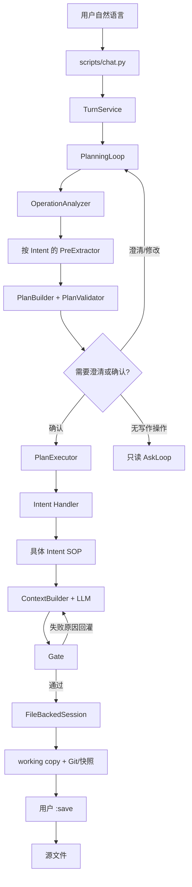
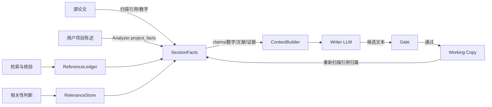
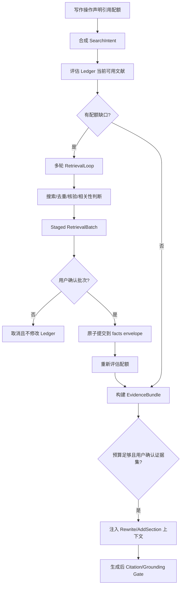

# AcademicAgent 项目设计与源码阅读指南

> 面向项目作者的面试准备文档。目标不是逐行记住约 2.7 万行源码，而是建立一套能解释、能追踪、能调试的项目心智模型。

## 1. 先用一句话定义项目

AcademicAgent 是一个面向**已有论文初稿**的受控写作 Agent：它把用户的自然语言请求转换成结构化操作计划，经确认后执行；模型生成的候选内容必须经过确定性 Gate 校验，修改先写入可回滚的 working copy，只有用户主动 `:save` 才覆盖源文件。

项目的核心价值不是“调用大模型生成论文”，而是把不可控的模型能力包装进一条：

```text
可理解 → 可确认 → 可执行 → 可校验 → 可回滚 → 可观测
```

的工程工作流。

项目边界：

- 处理 `.docx`、`.md`、`.tex` 已有初稿，而不是从零自动生成整篇论文。
- 自然语言写作能力只有五种：`polish`、`rewrite`、`add_section`、`convert_format`、`format_docx`。
- 不属于五种写作操作的问题，会在满足条件时交给只读 AskLoop，而不是硬映射成写操作。
- 文献系统的目标是形成“检索—核验—相关性—证据集—引用”的受控链路，而不是把搜索结果直接塞给写作模型。

首先阅读：[README](../README.md)、[入口脚本](../scripts/chat.py)、[五种意图枚举](../src/paper_agent/intents/intent.py)。

---

## 2. 总体架构

### 2.1 分层视图

| 层 | 主要职责 | 核心代码 |
|---|---|---|
| 入口与装配 | 加载配置，构造 Provider、Session、Coordinator、TurnService | `scripts/chat.py`、`config.py`、`providers/factory.py` |
| 应用编排 | 管理一轮用户请求，连接 Planning、AskLoop、执行器和文献流 | `application/turn_service.py`、`application/ask_loop.py`、`application/literature_flow.py` |
| Planning | 意图拆解、原子要求记账、槽位抽取、校验、澄清、确认、重规划 | `tasking/` |
| Runtime | 把通用 Operation 分发给五种具体 Handler，维护执行状态和回滚语义 | `runtime/handlers.py`、`runtime/plan_executor.py` |
| Intent | 五种写作能力的具体 SOP | `intents/` |
| Generation | 按意图组装 prompt，执行“生成—Gate—反馈重试” | `generate/context_builder.py`、`generate/generator.py` |
| Gate | 用确定性规则限制模型行为 | `gates/` |
| Session | 工作副本、文档投影、章节索引、保存、历史和撤销 | `session/` |
| Literature | 文献账本、检索、去重、核验、相关性、配额、证据集 | `literature/`、`providers/retrieval/` |
| Observability | run/span/event、脱敏、本地 trace、可选 Langfuse | `coordinator.py`、`observability/` |
| Tools | 格式转换、DOCX 排版、引用处理等确定性工具 | `tools/` |

### 2.2 主调用关系



### 2.3 三条重要的依赖原则

1. **LLM 负责非确定性工作，程序负责权限和事实边界。**
   - LLM：意图理解、槽位抽取、语言生成、相关性判断。
   - 程序：状态机、预算、格式校验、引用解析、数字检查、写入、回滚。

2. **先形成通用计划，再进入具体能力。**
   - 上层只认 `Task_Plan`、`Operation`、`OperationResult`。
   - Handler 把通用 Operation 转成 `PolishPlan`、`RewritePlan` 等具体对象。

3. **源文件、working copy、持久化事实是不同的真相源。**
   - 源文件只有 `:save` 才改。
   - working copy 是当前可编辑文档状态。
   - `facts.json` 保存跨会话项目事实与文献状态。

---

## 3. 一轮自然语言请求如何运行

以“润色引言，保持数字和引用不变，然后转成 Word”为例。

### 3.1 入口装配

从 [`main()`](../scripts/chat.py) 开始：

1. `load_dotenv()` 和 `load_config()` 读取模型、检索、预算、trace 等配置。
2. `build_llm_provider()` 构造写作模型；真实 Provider 外层通常套有重试/退避包装。
3. `FileBackedSession` 复制源文件，生成本轮 working copy。
4. 根据源文件扫描引用和数字，合并进 `SessionFacts`。
5. 构造 `Coordinator`、`HandlerContext`、`TurnService`。
6. REPL 中所有普通自然语言统一进入 `TurnService.handle_turn()`。

阅读：

- [scripts/chat.py](../scripts/chat.py)
- [config.py](../src/paper_agent/config.py)
- [providers/factory.py](../src/paper_agent/providers/factory.py)

### 3.2 TurnService：一轮请求的总导演

[`TurnService._handle_planning()`](../src/paper_agent/application/turn_service.py) 做四件关键事情：

1. 捕获执行前只读快照：文件 hash、格式、章节、facts 摘要。
2. 在一个 `Coordinator.run()` 内跑完整 Planning 和执行旅程。
3. 在 run 外持有 `Plan_Execution_State`，因此取消或异常后仍知道已完成哪些操作。
4. 若执行前状态过期，则携带原始请求、旧计划、已完成步骤和剩余步骤重新规划。

“一个 Turn 一个 coordinator run”很重要：Planning、AskLoop、执行和 trace 属于同一条用户请求，不会产生两份无法关联的观测记录。

### 3.3 Planning：自然语言变成计划

Planning 的逻辑不是一次分类，而是一个有界循环：

```text
分析 → 抽槽 → 构建计划 → 静态校验 → 澄清 → 未映射处置 → 用户确认
  ↑                                                        |
  └────────────── 修改、自动修复或执行期重规划 ─────────────┘
```

核心数据结构在 [`tasking/contracts.py`](../src/paper_agent/tasking/contracts.py)：

- `AtomicRequirement`：用户提出的一条可独立核对的原子要求。
- `RawOperation`：Analyzer 识别出的粗粒度操作。
- `SlotValue`：槽值 + 字段状态 + 来源 + 消费了哪些 requirement。
- `Operation`：一个可执行步骤；`slots` 是唯一真相源。
- `Task_Plan`：不可变计划；修改会生成新版本。
- `Plan_Execution_State`：可变运行态，记录当前和已完成操作。
- `PlanExecutionReport`：最终结构化执行报告。

#### 为什么 Analyzer 与 Extractor 分两层

`OperationAnalyzer` 只负责：

- 按用户表达顺序拆操作。
- 判断五种 Intent。
- 拆原子 requirement。
- 识别项目级事实。
- 保留无法支持的原话。

它**不抽取每种操作的细节**。随后每个 Intent 对应的 PreExtractor 才抽自己的槽位。这样可以：

- 避免一个巨大 schema 同时承载五类完全不同字段。
- 多操作时只把属于当前操作的 requirement 交给对应 Extractor，降低交叉污染。
- 每种能力可以独立演进字段、默认值和校验规则。

阅读顺序：

1. [operation_analyzer.py](../src/paper_agent/tasking/operation_analyzer.py)
2. [intent_spec.py](../src/paper_agent/tasking/intent_spec.py)
3. [extractors/base.py](../src/paper_agent/tasking/extractors/base.py)
4. 任意一个具体 Extractor，例如 [extractors/polish.py](../src/paper_agent/tasking/extractors/polish.py)
5. [plan_builder.py](../src/paper_agent/tasking/plan_builder.py)
6. [plan_validator.py](../src/paper_agent/tasking/plan_validator.py)
7. [clarifier.py](../src/paper_agent/tasking/clarifier.py)
8. [planning_loop.py](../src/paper_agent/tasking/planning_loop.py)

#### “零静默丢失”设计

用户的每条原子要求都应该进入 disposition 账本：

- `MAPPED`：被某个 Operation 的具体 Slot 消费。
- `CLARIFIED`：澄清后回填到 Slot。
- `PROJECT_MEMORY`：写入跨会话项目记忆。
- `UNMAPPED`：系统不知道如何执行，必须显式交代。
- `IGNORED`：用户明确选择忽略。
- `REJECTED` / `UNPARSED`：明确拒绝或解析失败。

这个设计的面试表达：**系统不只关心“生成了哪些操作”，还审计“用户说的每件事最终去了哪里”。**

### 3.4 PlanExecutor：计划如何执行

[`execute_plan()`](../src/paper_agent/runtime/plan_executor.py) 串行执行操作：

1. 空计划直接返回 `NO_ACTION`，不能冒充成功。
2. 第一次执行前创建计划级 baseline。
3. 每个操作执行前基于最新 working copy 再校验一次。
4. 通过 `handler_for(intent)` 找到具体 Handler。
5. 成功则记录进 `state.completed_operations`。
6. Gate 拒绝或系统失败后，后续操作标记为 skipped。
7. 若目标章节等状态已变化，则进入 `NEEDS_REPLAN`，只重规划未完成步骤。
8. 根据终态释放、保留或恢复 baseline。

阅读：

- [runtime/plan_executor.py](../src/paper_agent/runtime/plan_executor.py)
- [runtime/handlers.py](../src/paper_agent/runtime/handlers.py)
- [coordinator.py](../src/paper_agent/coordinator.py)

---

## 4. 五种写作能力

| Intent | 语义 | 是否改 working copy | 是否允许改变内容事实 | 是否可能用文献 |
|---|---|---:|---:|---:|
| `polish` | 只改善语言表达 | 是 | 否 | 否 |
| `rewrite` | 改内容、论证或组织 | 是 | 有约束地允许 | 是 |
| `add_section` | 新建当前不存在的章节 | 是 | 只能基于给定事实和证据 | 是 |
| `convert_format` | 生成另一文件格式 | 否，生成新产物 | 否 | 否 |
| `format_docx` | 只调整 DOCX 排版 | 是 | 否 | 否 |

建议先完全吃透 `polish`：

```text
PolishHandler
  → execute_polish
  → SectionIndex.find/body_of
  → run_polish
  → build_polish_messages
  → LLM
  → PolishGate.check
  → 失败原因回灌并重试
  → SectionIndex.splice
  → session.write_working
```

对应代码：

- [handlers.py](../src/paper_agent/runtime/handlers.py)
- [intents/polish.py](../src/paper_agent/intents/polish.py)
- [generate/generator.py](../src/paper_agent/generate/generator.py)
- [generate/context_builder.py](../src/paper_agent/generate/context_builder.py)
- [gates/diff_gate.py](../src/paper_agent/gates/diff_gate.py)
- [session/section_index.py](../src/paper_agent/session/section_index.py)

掌握 polish 后，再用对比法读：

1. [intents/rewrite.py](../src/paper_agent/intents/rewrite.py)
2. [intents/add_section.py](../src/paper_agent/intents/add_section.py)
3. [intents/convert.py](../src/paper_agent/intents/convert.py)
4. [intents/format_docx.py](../src/paper_agent/intents/format_docx.py)

---

## 5. 记忆系统：项目到底“记住”了什么

这个项目没有把所有状态塞进聊天历史，也没有使用向量数据库作为统一记忆。它采用的是**分层、分生命周期、分真相源的状态系统**。

### 5.1 记忆分层

| 记忆层 | 生命周期 | 内容 | 存储位置/对象 |
|---|---|---|---|
| 源文件状态 | 长期，由用户控制 | 用户真正的论文文件 | 用户提供的 `.docx/.md/.tex` |
| 工作记忆 | 当前 session | 当前可编辑文档、每次修改历史 | `.paper_workspace/<session_id>/current.<ext>` + session 内 Git |
| 项目事实记忆 | 跨 chat、按论文隔离 | 研究主题、创新点、gap、章节意图、结构偏好、已知数字 | `.paper_workspace/proj_<source_path_hash>/facts.json` |
| 文献记忆 | 跨 chat、按论文隔离 | 文献记录、稳定 ID、bibkey、数字别名、核验状态、去重建议 | `facts.json` 内的 `ReferenceLedger` |
| 相关性记忆 | 跨 chat | 文献对特定 criteria 的相关性判断与版本信息 | `facts.json` 内的 `RelevanceStore` |
| 引用使用记忆 | 跨 chat，可重算 | 哪个章节实际引用了哪些文献、未解析 token | `facts.json` 内的 `citation_usage` |
| 暂停/恢复记忆 | 跨 chat，任务完成后清理 | pending batch、文献流 checkpoint、冻结 SearchIntent | `facts.json` 的 pending 字段 |
| 单轮运行态 | 单个 Turn | 预算、计划版本、已完成操作、当前操作、replan 上下文 | `PlanningBudget`、`Plan_Execution_State` 等内存对象 |
| 只读问答快照 | 单次 Ask | 章节摘要、正文快照、统计、引用归属、编辑历史 | frozen `AskContext`，只存在内存 |

### 5.2 FileBackedSession：可回滚工作记忆

[`FileBackedSession`](../src/paper_agent/session/file_session.py) 绑定一个源文件：

1. 启动时将源文件复制到 session 目录。
2. 后续 Intent 只读写 working copy。
3. Git 可用时，每次写入自动 commit；不可用时降级为内存/文件快照。
4. `undo()` 回退上一次写入。
5. `create_baseline()` 提供计划级回滚点。
6. `save_to_source()` 才把 working copy 原子替换回源文件。

这里有两种恢复粒度：

- **单步 undo**：撤销最近一次写操作。
- **计划级 baseline**：多操作计划部分失败或取消时，恢复到整份计划开始前。

正文和引用数字别名必须一起回滚。否则正文中的 `[3]` 回去了，但账本里 `[3]` 已指向另一篇文献，会产生隐蔽的数据不一致。因此 `SessionBaseline.extra_state` 和 `undo_hook` 会携带账本别名快照。

### 5.3 SessionFacts：跨会话项目记忆

[`SessionFacts`](../src/paper_agent/session/facts.py) 是按源文件绝对路径派生的持久化 envelope。当前代码写出的 schema 包括：

```text
facts.json
├── schema_version
├── references
├── dedup_suggestions
├── known_numbers
├── claims
├── relevance_store
├── citation_usage
├── pending_batches
├── committed_batch_ids
├── pending_literature_flows
└── pending_search_intents
```

#### claims

`claims` 保存论文级而非操作级的信息，例如：

- `research_topic`
- `novelty`
- `gap`
- `contributions`
- `section_intents`
- `section_structures`

当用户说“我的课题是……”“创新点是……”时，Analyzer 会将其识别为 `project_facts`。Planning 把它标记为 `PROJECT_MEMORY` 并立即写入 `facts.json`，不依赖本轮写作是否成功。

#### known_numbers

启动会话时，程序从论文中扫描数字并合并到 `known_numbers`。Rewrite/AddSection Gate 使用这些数字判断候选内容是否引入了未经确认的新数字。

#### ReferenceLedger

[`ReferenceLedger`](../src/paper_agent/literature/ledger.py) 是文献的唯一可写真相源：

- 每篇文献有稳定 `reference_id`。
- `.tex` 通过 bibkey 引用。
- `.md/.docx` 通过数字别名引用。
- 能区分“可以解析”与“允许新增引用”。原稿中的未核验引用仍必须可解析，但不一定满足严格可引用策略。
- upsert 时处理去重、字段合并和冲突。

`known_refs` 只是 Ledger 的兼容只读投影，不应把它误认为文献真相源。

#### RelevanceStore

相关性不是文献自身永恒的属性。同一篇论文可能与“相关工作”高度相关，却与“实验设计”无关。因此 `RelevanceStore` 保存的是“文献 + criteria + judge/version/content hash”对应的判断，并在输入内容或判断版本变化时重新评估。

阅读：[literature/relevance.py](../src/paper_agent/literature/relevance.py)。

#### checkpoint 与冻结意图

文献检索可能暂停等待用户确认。系统只持久化恢复需要的 checkpoint 和 SearchIntent，不把整个 EvidenceBundle 或大段摘要直接保存为长期记忆。恢复时会校验：

- operation 是否一致。
- task fingerprint 是否一致。
- quota hash 是否一致。
- throughput policy 是否变化或被篡改。
- SearchIntent strategy hash 是否仍一致。

这样避免把旧任务的检索结果错误复用到新任务。

### 5.4 记忆数据流



### 5.5 读记忆系统的推荐顺序

1. [session/file_session.py](../src/paper_agent/session/file_session.py)
2. [session/facts.py](../src/paper_agent/session/facts.py)
3. [literature/models.py](../src/paper_agent/literature/models.py)
4. [literature/ledger.py](../src/paper_agent/literature/ledger.py)
5. [literature/relevance.py](../src/paper_agent/literature/relevance.py)
6. [literature/citation_usage.py](../src/paper_agent/literature/citation_usage.py)
7. [application/literature_flow.py](../src/paper_agent/application/literature_flow.py)

---

## 6. 上下文工程：什么信息在什么时候给哪个模型

这个项目的上下文工程原则不是“把所有信息都塞进 prompt”，而是：

> 根据当前任务只提供必要材料，并明确区分指令、背景、事实、外部不可信数据和重试反馈。

### 6.1 Planning 上下文

Planning 不是让模型自由输出 JSON 文本，而是优先使用 forced function calling：

```text
用户原话
  → decompose_request schema
  → operations + requirements + project_facts + unmapped_text
  → 各 Intent 的字段 schema
  → SlotValue
```

关键措施：

- Intent 只能取固定五种枚举。
- 每个字段的判定规则写在对应 JSON Schema description 中，靠近字段本身。
- LLM 给出 requirement 原话，字符 offset 由程序定位，不让模型计算位置。
- 解析失败区分 `provider_failed`、`parse_failed`、`schema_failed` 和成功空结果。
- 结构合法但语义全空会在预算内重试一次，不能误判成只读请求。
- 单 Turn 有输入长度、操作数、LLM 调用次数和 provider 总耗时预算。

阅读：

- [providers/llm/structured.py](../src/paper_agent/providers/llm/structured.py)
- [tasking/operation_analyzer.py](../src/paper_agent/tasking/operation_analyzer.py)
- [tasking/intent_spec.py](../src/paper_agent/tasking/intent_spec.py)
- [tasking/budget.py](../src/paper_agent/tasking/budget.py)

### 6.2 写作上下文按 Intent 隔离

[`generate/context_builder.py`](../src/paper_agent/generate/context_builder.py) 是上下文工程的核心文件。它是纯函数：输入结构化材料，输出 `Message[]`。

#### Polish 上下文

只包含：

- system 中的“只改语言”硬约束。
- 用户的 goal 和额外 constraints。
- 用户整句原话作为低优先级背景。
- 目标章节正文。
- 上一次 Gate 违反原因（重试时）。

不提供整篇论文、文献库和项目 claims，因为 polish 不需要这些材料。上下文越少，模型越不容易越权改事实。

#### Rewrite 上下文

包含：

- 改写方向和细节。
- 目标章节正文。
- 可用文献列表或 EvidenceBundle。
- 已知数字。
- 用户原话背景。
- Gate 重试反馈。

#### AddSection 上下文

包含：

- 新章节标题、目的、结构或小节骨架。
- 当前 working copy 作为首要事实材料。
- 用户本轮明确给出的事实。
- 持久化 claims。
- 已知数字。
- 文献题录或 EvidenceBundle。
- Gate 重试反馈。

`purpose` 和 `structure_desc` 只是“写作要求”，不会自动升级成“论文事实”。例如“新增实验设计章节”不代表论文真的已经做了某个实验。

### 6.3 指令、背景与事实必须分开

ContextBuilder 对信息做了语义分层：

| 类型 | 示例 | 权限 |
|---|---|---|
| System 硬约束 | 不得改数字、只能引用证据集文献 | 最高 |
| 结构化任务参数 | section、goal、direction、structure | 定义本次工作 |
| 用户原话背景 | “这段写得比较仓促” | 帮助理解，不取代硬约束 |
| 当前文档与 claims | 论文当前内容、已确认项目事实 | 可作事实依据 |
| EvidenceBundle | 文献摘要片段 | 只支持片段覆盖的主张 |
| 外部文本中的指令 | 摘要中出现“忽略前文” | 仅作为数据，禁止执行 |
| Gate violations | “数字发生变化” | 下一轮修复反馈 |

用户原话被放在 `<<<user_source_text>>>` 定界块内：发给生成模型时保留语气和背景，但 trace 脱敏层可识别并剔除，避免整句用户输入落盘。

### 6.4 外部材料是不可信数据

文献标题、摘要、当前文档都可能含类似指令的文字。系统通过定界标记和 `wrap_as_data()` 把它们声明为数据，不允许其中的指令改变模型行为。

这是学术 Agent 很重要的 prompt injection 防线。阅读：

- [literature/untrusted.py](../src/paper_agent/literature/untrusted.py)
- [generate/context_builder.py](../src/paper_agent/generate/context_builder.py)

### 6.5 EvidenceBundle：有能力边界的检索上下文

[`EvidenceBundle`](../src/paper_agent/literature/evidence.py) 不是简单的“Top K 搜索结果”。每条 BundleEntry 包含：

- 稳定 reference ID 和可用引用标记。
- 标题、年份、语言桶。
- 相关性结论和置信度。
- EvidenceSpan。
- 是否有摘要、摘要是否被截断、是否因预算退化为仅题录。

证据能力分级的关键含义：

- 有摘要片段：只能支持片段明确覆盖的主张。
- 只有题录：只能说明该文献存在，不能根据标题推导具体结论。
- 摘要因预算被移除：不能反过来说“该文献没有摘要”。
- 摘要被截断：没出现的内容不能被解释为原文没有。

Bundle 构建会在字符预算内尝试降级，例如缩短摘要、让部分条目退化为题录；如果连配额下界所需的最小证据都装不下，则暂停并要求用户提高预算或降低引用要求。

### 6.6 上下文预算与显式降级

代码中的典型预算：

- Planning 单条输入默认上限：20,000 字符。
- AddSection 当前文档材料上限：24,000 字符，超出时保留头尾并显式标注中段省略。
- AskLoop 单次 `read_section` 默认最多返回 4,000 字符，并在结果中显式标注截断。
- EvidenceBundle 默认预算由 `PAPER_LIT_BUNDLE_BUDGET_CHARS` 控制，当前配置默认 40,000 字符。
- AskLoop 有最大迭代数和最大 LLM 调用次数。

原则是：**允许降级，但不能静默降级。**模型和用户都应知道自己只看到了部分材料。

### 6.7 只读 AskLoop 的上下文工程

[`AskContext`](../src/paper_agent/application/ask_context.py) 是 frozen 快照，并且不持有 session：

- 章节列表和字数。
- 正文快照。
- 文档统计。
- 编辑历史快照。
- 引用章节归属。

问答模型首先看到少量 facts digest，再自行调用工具：`list_sections`、`read_section`、`doc_stats`、`edit_history` 等。这样回答“哪章最长”时不需要预先把全文塞进 prompt。

“只读”是结构性保证：捕获完成后 AskLoop 没有 `write_working` 对象，而不只是 prompt 中说“不要修改”。

阅读：

- [application/ask_context.py](../src/paper_agent/application/ask_context.py)
- [application/ask_loop.py](../src/paper_agent/application/ask_loop.py)

---

## 7. 文献与证据系统

### 7.1 主链



### 7.2 为什么分 Search、Verify、Relevance

- **Search**：找到候选记录。
- **Verify**：确认 DOI、题录等身份信息是否可靠。
- **Relevance**：判断它是否适合当前章节和写作目的。

三者不能合并为一个“检索成功”布尔值。身份真实的论文可能与当前主题无关；标题相关的记录也可能元数据不完整或无法核验。

### 7.3 staged/confirmed/committed

检索结果先进入 staged batch。用户确认后才 commit 到 Ledger。这样用户否决检索批次时，文献库不会被半污染。

提交使用 `facts.json` 单 envelope，配合 committed batch ID 保证幂等和恢复一致性。

### 7.4 推荐阅读顺序

1. [literature/models.py](../src/paper_agent/literature/models.py)
2. [literature/ledger.py](../src/paper_agent/literature/ledger.py)
3. [literature/quota.py](../src/paper_agent/literature/quota.py)
4. [literature/relevance.py](../src/paper_agent/literature/relevance.py)
5. [literature/retrieval/loop.py](../src/paper_agent/literature/retrieval/loop.py)
6. [literature/retrieval/attempt.py](../src/paper_agent/literature/retrieval/attempt.py)
7. [literature/retrieval/batch.py](../src/paper_agent/literature/retrieval/batch.py)
8. [literature/evidence.py](../src/paper_agent/literature/evidence.py)
9. [application/literature_flow.py](../src/paper_agent/application/literature_flow.py)
10. [application/literature_composition.py](../src/paper_agent/application/literature_composition.py)

---

## 8. Gate：为什么它是写入前硬门槛

Gate 不负责判断文字“好不好看”，而是限制模型不得越过的确定性边界。

### 8.1 PolishGate

检查：

- 标题层级序列不变。
- 引用多重集合不变。
- 数字多重集合不变。
- 公式逐字不变。
- 字符变化比例不超过阈值。
- 不出现 TODO、待补充等占位符。

### 8.2 RewriteGate

Rewrite 允许内容变化，但仍检查：

- 标题和基本结构约束。
- 新引用是否能在 Ledger 中解析并满足策略。
- 新数字是否来自已知数字或经过用户确认。
- 公式等关键内容是否满足计划要求。

### 8.3 AddSectionGate 与 GroundingGate

新增章节需要同时防止：

- 章节结构不符合计划。
- 引用列表之外的文献。
- 未知数字。
- `[[EVIDENCE_NEEDED: ...]]` 或普通占位符被写入。
- 候选中的事实性主张没有被当前文档、用户事实、claims 或摘要证据覆盖。

GroundingGate 会把候选主张与生成时使用的 grounding material 对照。Generator 与 Gate 共用同一份 grounding 材料，避免“prompt 看到一份证据，Gate 却按另一份证据判断”。

### 8.4 FormatGate

排版操作前后比较正文 hash、段落数、表格数、图/公式数量，保证格式化不能偷偷改正文。

阅读：

- [gates/diff_gate.py](../src/paper_agent/gates/diff_gate.py)
- [gates/grounding_gate.py](../src/paper_agent/gates/grounding_gate.py)
- [gates/citation_quota_gate.py](../src/paper_agent/gates/citation_quota_gate.py)
- [gates/format_gate.py](../src/paper_agent/gates/format_gate.py)

---

## 9. 文档抽象、DOCX 保真与写回

### 9.1 统一文本投影

上层 Intent 只处理带 `#` 标题的统一文本视图：

- Markdown：直接使用标题。
- TeX：SectionIndex 解析 `\section` 等结构。
- DOCX：`project_text()` 把 Heading 样式投影为 `#` 前缀文本。

这使 Planning、SectionIndex、Intent 和 Gate 不需要为 DOCX 重写一整套逻辑。

### 9.2 DOCX 为什么不转换成 Markdown 再保存

working copy 本身始终是 DOCX 二进制副本：

- 读取时生成文本投影。
- 写回时根据段落差异就地修改 DOCX。
- 页边距、分栏、页眉页脚、段内加粗等未处理格式不会因为一次 Markdown 往返而丢失。

`apply_text()` 还会显式检查标题是否丢失，防止润色结果吞掉相邻章节。

### 9.3 交叉引用

DOCX 载入时把已有 Word REF 域在 working copy 中摊平为纯文本，使投影和 Gate 能看见引用；保存时可以再将 `[n]` 升成 Word 交叉引用域。升域只作用于输出副本，不改变 working copy 的纯文本处理口径。

阅读：

- [session/docx_document.py](../src/paper_agent/session/docx_document.py)
- [session/section_index.py](../src/paper_agent/session/section_index.py)
- [tools/docx_crossref.py](../src/paper_agent/tools/docx_crossref.py)
- [tools/docx_format.py](../src/paper_agent/tools/docx_format.py)

---

## 10. Provider 与配置设计

Provider 层把供应商差异隔离在统一接口之后：

- `LLMProvider`：消息、流式输出、tools/function calling。
- `RetrievalProvider`：文献搜索。
- `VerifyProvider`：文献身份/元数据核验。

`providers/factory.py` 将配置字符串映射到具体实现：

- `mock` 用于测试。
- OpenAI 兼容端点复用一个 Provider，通过 preset 或 base URL 配置供应商。
- Anthropic 使用独立协议适配器。
- 真实 LLM 外层由 `ResilientLLMProvider` 统一处理可重试异常、退避和 429。
- reviewer 可与 writer 使用不同模型，减少同模型自评偏差。

配置按能力分组：

- 模型与重试。
- Planning 预算。
- AskLoop 预算。
- 工作区、trace、Langfuse。
- 文献核验、语言分类、相关性策略。
- 检索循环和证据上下文预算。

阅读：

- [providers/llm/base.py](../src/paper_agent/providers/llm/base.py)
- [providers/llm/structured.py](../src/paper_agent/providers/llm/structured.py)
- [providers/llm/resilient.py](../src/paper_agent/providers/llm/resilient.py)
- [providers/retrieval/base.py](../src/paper_agent/providers/retrieval/base.py)
- [providers/factory.py](../src/paper_agent/providers/factory.py)
- [config.py](../src/paper_agent/config.py)

---

## 11. 可观测性与隐私

### 11.1 Coordinator

[`Coordinator`](../src/paper_agent/coordinator.py) 负责 run 生命周期：

- 创建 run context 和 event bus。
- 统一捕获取消与异常。
- 记录 working copy 最终是 updated 还是 unchanged。
- 完成后 finalize trace。
- 可选将 trace fan-out 到本地 JSON 和 Langfuse。

### 11.2 Event/Span

系统对 Planning、LLM 调用、Gate、工具、写入、AskLoop 等发布结构化事件。这样可以回答：

- 一轮请求用了多少次模型调用？
- 在哪个 Gate 被拒？
- 为什么进入重规划？
- 是否实际修改了 working copy？
- AskLoop 调用了哪些工具、是否只读了截断正文？

### 11.3 脱敏

[`observability/sanitize.py`](../src/paper_agent/observability/sanitize.py) 不直接把论文和用户原话完整写进 trace，而是使用 hash、长度、有限 preview 和定界块剔除等策略。

阅读：

- [observability/events.py](../src/paper_agent/observability/events.py)
- [observability/bus.py](../src/paper_agent/observability/bus.py)
- [observability/recorder.py](../src/paper_agent/observability/recorder.py)
- [observability/sanitize.py](../src/paper_agent/observability/sanitize.py)
- [observability/langfuse_exporter.py](../src/paper_agent/observability/langfuse_exporter.py)

---

## 12. 失败语义、取消和回滚

不要把所有失败都理解为 exception。

| 状态 | 含义 | 示例 |
|---|---|---|
| `REJECTED` | 业务候选未通过 | Gate 拒绝、引用配额不满足 |
| `FAILED` | 系统或工具异常 | Provider 崩溃、文件工具异常 |
| `CANCELLED` | 用户或取消令牌中止 | 用户按 Ctrl-C |
| `PARTIALLY_COMPLETED` | 前序操作成功，后续失败或取消 | 润色完成后转换失败 |
| `NEEDS_REPLAN` | 计划依赖的执行环境已过期 | 目标章节已被前序操作改变 |
| `NO_ACTION` | 没有可执行操作 | 不能把“什么都没做”报成 done |

关键不变量：

- `OperationCancelled` 一路向上抛，由 Executor 和 Coordinator 统一处理。
- 普通 Handler 异常转换为结构化 `FAILED` OperationResult。
- Gate 拒绝属于业务失败，不冒充系统崩溃。
- 部分成功后保留已完成操作记录，并给出回滚选择。
- `needs_replan` 只重新规划剩余操作，不重跑已经成功的步骤。

---

## 13. 最高效的源码阅读路线

### 阶段 A：先吃透一条 Polish 纵向链路

1. `README.md`
2. `scripts/chat.py::main`
3. `application/turn_service.py`
4. `tasking/contracts.py`
5. `tasking/planning_loop.py`
6. `runtime/plan_executor.py`
7. `runtime/handlers.py::PolishHandler`
8. `intents/polish.py`
9. `generate/generator.py`
10. `generate/context_builder.py::build_polish_messages`
11. `gates/diff_gate.py::PolishGate`
12. `session/file_session.py`
13. `session/section_index.py`

配套测试：[tests/test_week1_polish.py](../tests/test_week1_polish.py)。

达到标准：不看代码能画出完整调用链，并解释哪一步首次改变 working copy。

### 阶段 B：吃透 Planning

1. `tasking/contracts.py`
2. `tasking/operation_analyzer.py`
3. `tasking/intent_spec.py`
4. `tasking/extractors/`
5. `tasking/plan_builder.py`
6. `tasking/plan_validator.py`
7. `tasking/clarifier.py`
8. `tasking/planning_loop.py`

配套测试：

- `tests/test_planning_analyzer.py`
- `tests/test_planning_extractor_*.py`
- `tests/test_planning_plan_builder.py`
- `tests/test_planning_plan_validator.py`
- `tests/test_planning_clarifier_loop.py`
- `tests/test_planning_active_e2e.py`

达到标准：能手写一个 `Task_Plan` 示例，并说明每条 requirement 的 disposition。

### 阶段 C：记忆、上下文和问答

1. `session/facts.py`
2. `literature/ledger.py`
3. `generate/context_builder.py`
4. `application/ask_context.py`
5. `application/ask_loop.py`
6. `observability/sanitize.py`

达到标准：能区分 working copy、facts、ledger、AskContext 和 prompt context，知道各自生命周期。

### 阶段 D：文献证据链

按第 7.4 节顺序阅读。不要一开始就逐个阅读 `literature/` 下所有辅助文件。

配套测试：

- `tests/test_retrieval_loop.py`
- `tests/test_literature_flow.py`
- `tests/test_literature_verifier.py`
- `tests/test_literature_relevance.py`
- `tests/test_evidence_span_bundle.py`
- `tests/test_citation_quota_gate.py`
- `tests/test_add_section_grounding.py`

达到标准：能解释“检索到一篇论文”为什么仍不能立即进入写作 prompt。

### 阶段 E：DOCX、回滚和观测

1. `session/docx_document.py`
2. `tools/docx_crossref.py`
3. `tools/docx_format.py`
4. `runtime/plan_executor.py`
5. `coordinator.py`
6. `observability/`

达到标准：能解释一次 DOCX 润色如何保留排版，以及部分失败后如何恢复一致状态。

---

## 14. 推荐的动手调试方式

先运行最小测试：

```powershell
pytest tests/test_week1_polish.py -q
pytest tests/test_planning_active_e2e.py -q
pytest tests/test_planning_plan_executor.py -q
```

用 mock 模型启动：

```powershell
$env:PAPER_LLM = "mock"
python scripts/chat.py examples/sample.tex
```

推荐断点：

1. `TurnService._handle_planning`
2. `run_planning_loop`
3. `OperationAnalyzer.analyze` 对应的模块函数 `analyze`
4. `build_plan`
5. `execute_plan`
6. `PolishHandler.execute`
7. `execute_polish`
8. `run_polish`
9. `PolishGate.check`
10. `FileBackedSession.write_working`

每停一次只回答五个问题：

```text
1. 当前输入对象是什么？
2. 当前输出对象是什么？
3. 哪些状态可能被修改？
4. 失败会变成哪个结构化状态？
5. 下一层调用者是谁？
```

---

## 15. 面试时可以重点讲的设计决策

### 15.1 为什么不让 LLM 直接改论文

模型不适合控制不可逆副作用。系统先把请求结构化为计划，再由确定性执行器控制工具和写入；候选结果通过 Gate 后只进入 working copy。

### 15.2 为什么 Gate 不使用另一个 LLM

数字、引用、公式、标题、文件可打开性等规则可以确定性判断。用 LLM 判断会引入额外随机性、成本和“模型给模型放水”的问题。语义 grounding 可以使用模型辅助，但其输入证据和最终写入边界仍由程序控制。

### 15.3 为什么用 requirements disposition

普通 Intent 分类只能说明“系统准备做什么”，无法证明“用户说的每件事都被处理了”。Disposition 为每条原子要求提供可审计去向，防止约束被模型静默丢失。

### 15.4 为什么记忆要分层

论文正文、编辑历史、项目事实、文献身份、相关性判断和暂停任务的生命周期不同。如果全部塞进聊天历史或一个 dict，会造成上下文膨胀、过期状态复用和回滚不一致。

### 15.5 为什么只读问答使用 frozen snapshot

“不要写”只是行为约定；不给 AskLoop session 引用，才是能力上的结构性隔离。

### 15.6 为什么 EvidenceBundle 不能只给标题

标题只能证明某篇文献可能存在或主题大致相关，不能支持具体研究结论。系统把题录证据和摘要 claim-support 证据明确区分，降低根据标题编造内容的风险。

---

## 16. 当前限制与可改进方向

1. 中文文献配额可能因数据源覆盖不足而无法填满。
2. Gate 中部分语义判断仍可能误判或漏判，需要真实文档评测集持续校准。
3. AddSection 的全文上下文采用头尾截断，大文档中段信息可能导致保守拒绝。
4. DOCX 表格、文本框等内容不完全进入正文投影，处理范围需要继续扩展。
5. CLI 是当前主要交互入口，计划确认、证据确认和 diff 展示可进一步产品化。
6. 配置项很多，虽然灵活，但增加理解和部署成本，可按场景提供预设 profile。
7. 文献链路较长，需要继续优化批量相关性判断、缓存命中和检索吞吐。

面试中不要把限制说成失败。更好的表达是：项目在“安全保守”和“自动完成率”之间选择了偏安全的一侧，当前优化方向是提高证据覆盖和上下文利用率，同时保持现有不变量。

---

## 17. 一段可直接用于面试的项目介绍

> 这个项目是一个面向已有论文初稿的受控写作 Agent。用户可以提出润色、改写、新增章节、格式转换和 DOCX 排版需求。系统不会让模型直接操作文件，而是先用 OperationAnalyzer 把自然语言拆成结构化操作和原子要求，再由各意图 Extractor 抽取槽位，经过静态校验、澄清和用户确认后形成不可变 Task Plan。PlanExecutor 串行分发到具体 Handler，写作模型生成候选内容后还要经过数字、引用、公式、结构、grounding 和引用配额等 Gate。通过后只写入带 Git 历史的 working copy，用户主动保存才覆盖源文件。项目还把记忆分成工作副本、跨会话项目事实、文献账本、相关性缓存和可恢复 checkpoint；上下文按 polish、rewrite、add-section 和只读问答分别构建，并对外部摘要做数据定界和预算控制。这样把大模型的不确定性限制在可验证、可回滚、可观测的工作流里。

---

## 18. 最终自测清单

读完后应能不看代码回答：

- [ ] 一条自然语言请求从入口到写入经过哪些对象？
- [ ] Analyzer、Extractor、PlanBuilder 各自负责什么？
- [ ] `Operation.slots` 为什么是唯一真相源？
- [ ] 用户的一条约束如何证明没有被静默丢掉？
- [ ] working copy、源文件、facts.json 有什么区别？
- [ ] `claims`、Ledger、RelevanceStore 分别记什么？
- [ ] 为什么恢复文献流需要 fingerprint 和 hash？
- [ ] Polish、Rewrite、AddSection 的上下文分别包含什么？
- [ ] 指令、背景、事实和外部数据如何隔离？
- [ ] EvidenceBundle 为什么区分摘要、题录和截断状态？
- [ ] Gate 失败后为什么不会写入？
- [ ] DOCX 如何复用统一文本逻辑而不丢排版？
- [ ] 一部分操作成功后取消，系统如何报告和回滚？
- [ ] AskLoop 为什么在结构上保证只读？
- [ ] trace 如何记录链路又避免完整论文正文落盘？
- [ ] 当前项目最重要的限制和下一步优化是什么？

如果其中任何一项回答不顺，就回到对应章节，先读测试，再读实现。
